<p align="center">
  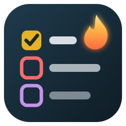
</p>

<h1 align="center">TodoForge</h1>

<p align="center">
  <b>Every TODO in your code, in one tree, with owners, due dates and a Changes view for your branch.</b><br>
  Fast on big .NET and web repos. Offline. No account. No telemetry.
</p>

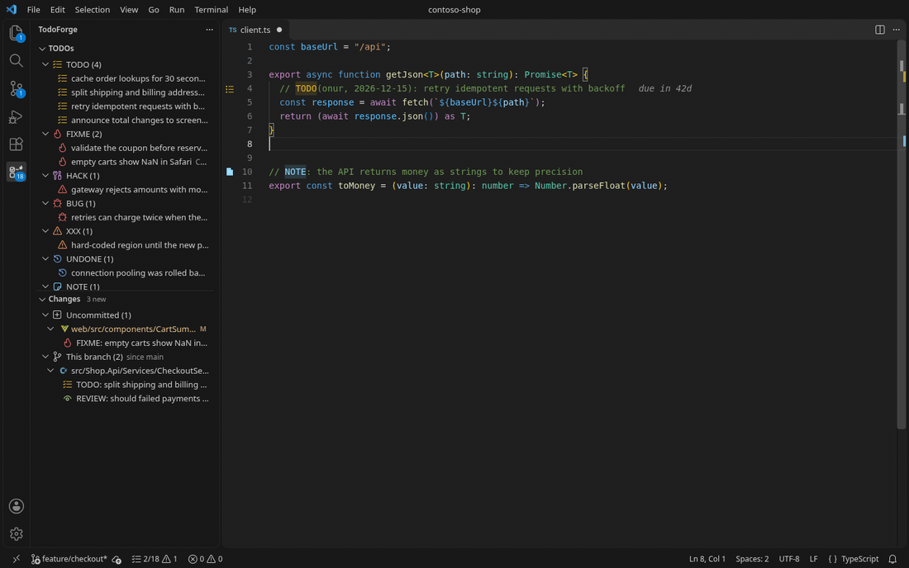

## Why TodoForge

- **Works on install.** Open a folder and the TODO tree fills in. `bin/`, `obj/`, `node_modules/`, generated C# and minified files are skipped out of the box, and `.gitignore` is honored.
- **TODOs that carry meaning.** Write `TODO(onur, 2026-12-01, !high, #perf): …` and get an owner, a due date that turns red when overdue, a priority and labels. Every part is optional.
- **See what you are adding.** The **Changes** view lists TODOs you have not committed and TODOs added on your branch, from local git. Check it before you open a pull request.
- **Act from the line.** Hover a TODO for who wrote it and when, then Snooze, set a date, set a priority, pin or remove it with one click or **Ctrl+.**
- **Private by design.** Nothing leaves your machine. No sign-in, no telemetry, no network calls. AI help is off unless you turn it on.

## Features

### A tree of every TODO

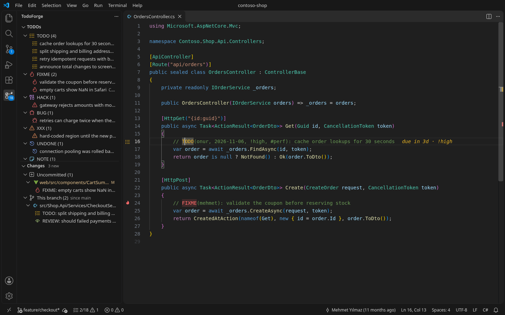

- Group by **tag**, **file**, **owner**, **label** or a flat list. Sort by location, priority, due date or age.
- Finds `TODO FIXME HACK BUG XXX UNDONE NOTE REVIEW OPTIMIZE` and your own tags. `NOTE`, `BUG`, `REVIEW` and `OPTIMIZE` only count with a `:` or `(`, so “// Note that…” is not a TODO.
- Reads real comments in 70+ file types, including Vue, Svelte, JSX/TSX, Astro, Razor, LaTeX and INI files. A `todoList` variable or a `"TODO"` string is not a TODO.
- In C#, also lists `throw new NotImplementedException()`, `[Obsolete]` and `#warning`.
- Markdown checklists (`- [ ]`) get their own group; tick them from the tree.
- **Pins** keep the TODOs you care about at the top, and follow the line when the file changes. Drag to reorder.
- **Mute** a TODO you never want to see again in this workspace.

### Highlights that follow your theme

Tags are colored in the editor, the gutter and the overview ruler, with separate light and dark colors that pass WCAG AA contrast on the light theme. Recolor built-in tags from your theme with `workbench.colorCustomizations` (`todoforge.todoForeground`, `todoforge.fixmeForeground`, …).

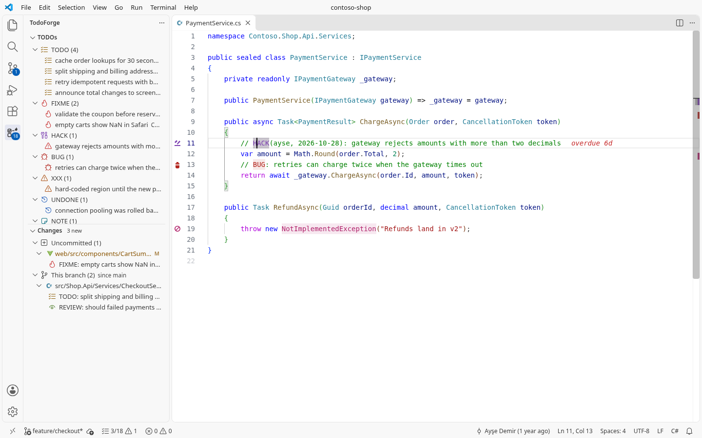

### Owners, due dates and priorities

```csharp
// TODO(onur, 2026-12-01, !high, #perf): cache the price lookup
// FIXME(@ayse): null check before Save()
// HACK(2026-11-15): remove after the API fix ships
```

- Overdue and due-soon TODOs show a hint at the end of the line (`overdue 6d`, `due in 3d · !high`).
- Type `todo` in a comment and pick **TODO(owner, date)** to get the snippet.
- Your name comes from `todoforge.syntax.owner` or your local `git config user.name`.

| Hover card | Quick fixes |
| --- | --- |
| 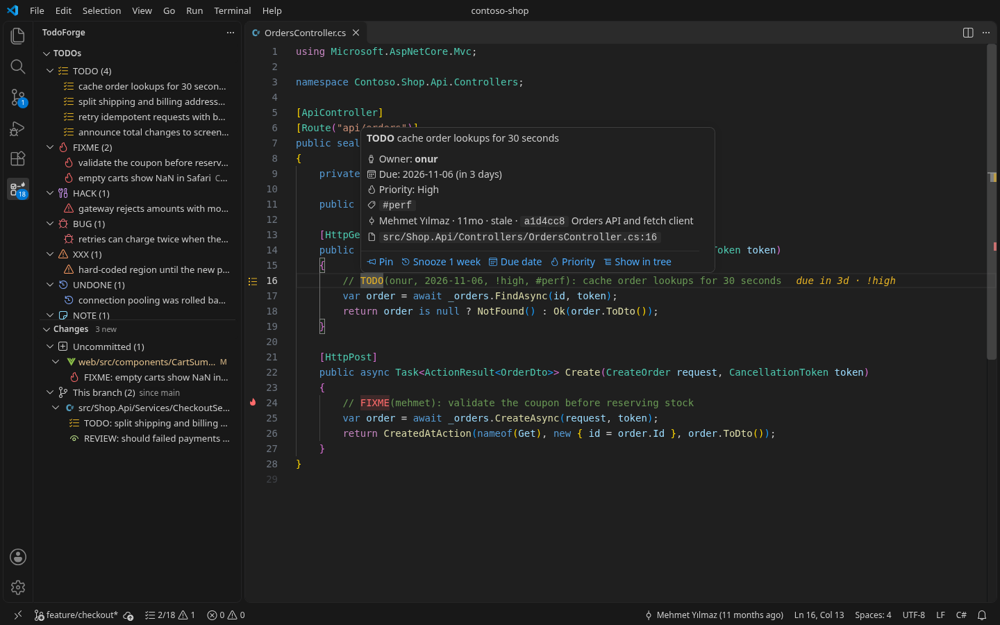 | 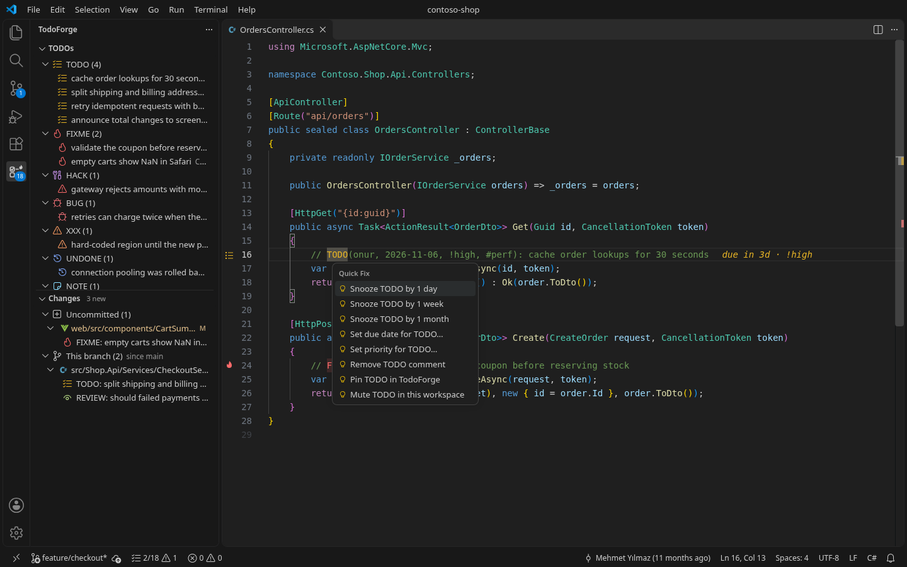 |

### Changes: TODOs on your branch

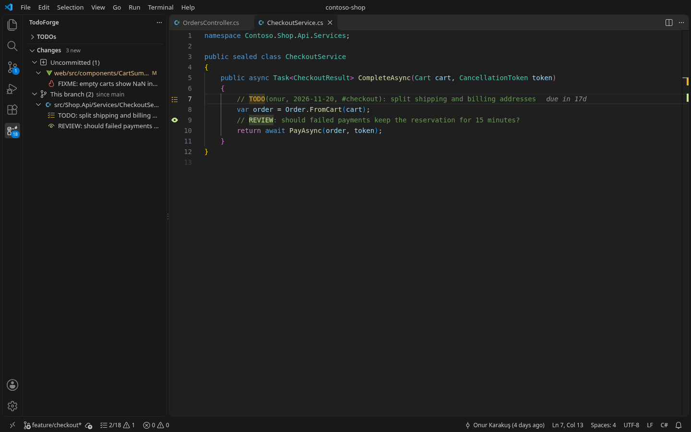

TodoForge runs read-only local git commands (`git diff`, `git ls-files`, `git merge-base`, `git blame`) to split TODOs into **Uncommitted** and **This branch**. The base branch is detected (`origin/HEAD`, `main`, `master`, `develop`) or set with `todoforge.git.baseBranch`. Nothing is fetched.

### Filter as you type

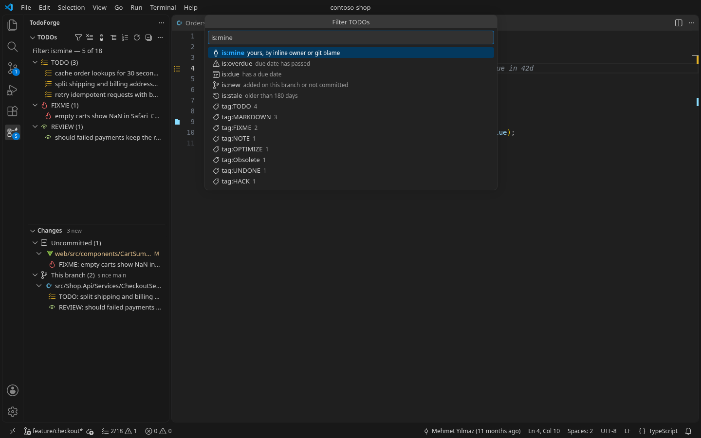

| Query | Shows |
| --- | --- |
| `is:mine` | yours, by inline owner or git blame |
| `is:overdue`, `is:due` | past due, has a due date |
| `is:new` | uncommitted or added on this branch |
| `is:stale` | older than `todoforge.stale.afterDays` (git blame) |
| `tag:FIXME,BUG` | these tags |
| `@ayse`, `#perf`, `path:src/api` | owner, label, path |
| `-word`, `-tag:NOTE` | exclude |

Save any filter as a **view**. Built-in views: My TODOs, Overdue, Due dates, New on this branch, Stale, FIXME and BUG, .NET code markers.

### Insights

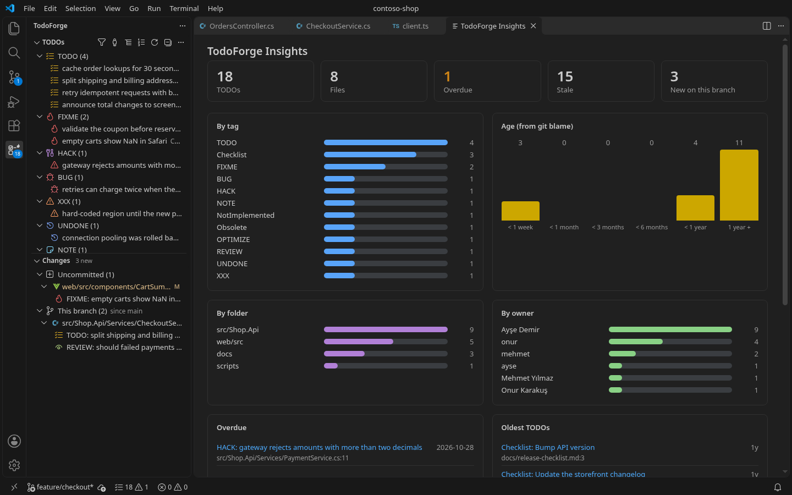

Counts by tag, folder and owner, age from git blame, and the overdue and oldest TODOs. It is a local webview with a strict content security policy: no scripts or styles from the network.

### Get started in a minute

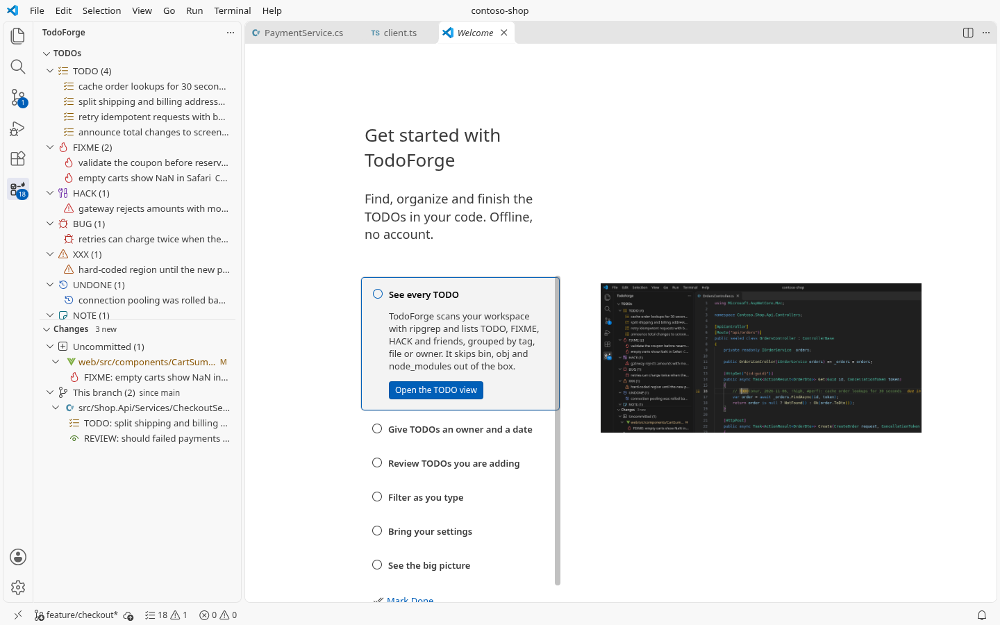

The walkthrough opens from **TodoForge: Get Started**. Coming from Todo Tree, JetBrains Rider/ReSharper or Visual Studio? **TodoForge: Import Settings** brings your tags and excludes in one step.

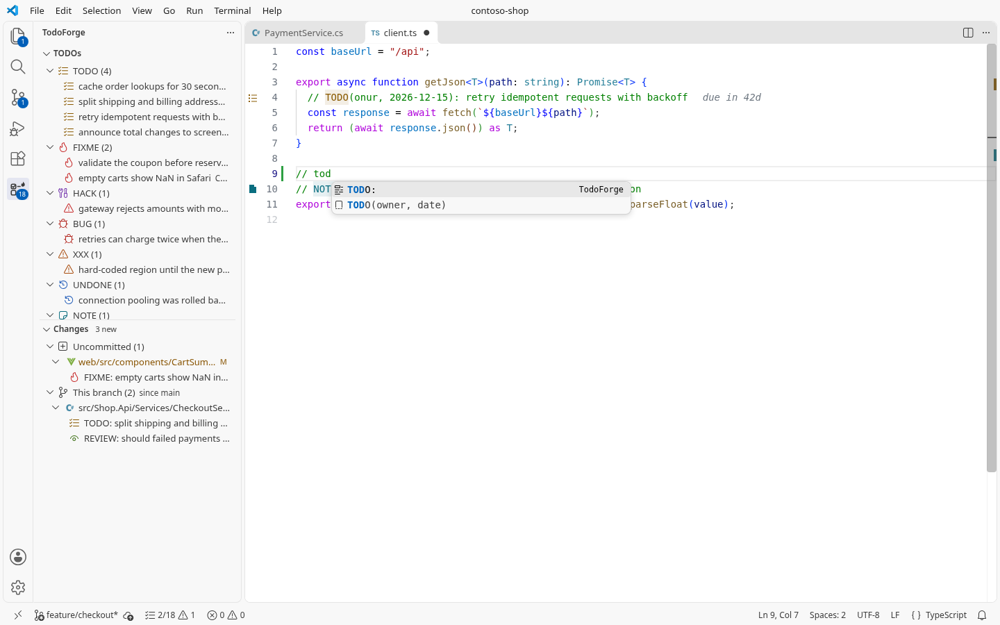

## TodoForge and Todo Tree

Todo Tree is the extension most people know. TodoForge covers the same daily job and adds what individual developers kept asking for. Comparison with Todo Tree 0.0.226 (April 2023, its latest release as of November 2026).

| | TodoForge | Todo Tree |
| --- | --- | --- |
| Tree of TODOs, editor highlights, custom tags | ✓ | ✓ |
| Works without extra setup on .NET (`bin/`, `obj/`, generated files) | ✓ | needs exclude globs |
| Ships its own ripgrep | ✓ per-platform build | uses the one inside VS Code |
| Comment-aware matching (not in strings or names) | ✓ per language | one regex for all files |
| Owner, due date, priority, labels in the comment | ✓ | – |
| Hover card, quick fixes, snippet | ✓ | – |
| Changes view (uncommitted / this branch) | ✓ | – |
| Git blame age and author, `is:mine`, stale | ✓ | – |
| Pins, mute, saved views, live filter query | ✓ | filter text only |
| Theme colors with light-theme contrast | ✓ | custom colors |
| Insights panel | ✓ | – |
| Import Todo Tree settings | ✓ | – |

Todo Tree still has more highlight knobs (per-tag regex, line styles, icons from many sets). If you rely on one TodoForge does not have, tell us in an issue.

## Commands and keys

| Command | Key |
| --- | --- |
| Go to Next TODO in File | `Ctrl+Alt+PageDown` (`Cmd+Alt+PageDown`) |
| Go to Previous TODO in File | `Ctrl+Alt+PageUp` (`Cmd+Alt+PageUp`) |
| Filter… (when the tree has focus) | `Ctrl+Alt+F` (`Cmd+Alt+F`) |
| Quick fixes on a TODO | `Ctrl+.` (`Cmd+.`) |
| Go to TODO… | Command Palette |
| Show My TODOs / Show All TODOs | Command Palette, tree toolbar |
| Open Saved View… / Save Current View… | Command Palette, tree menu |
| Show Insights | Command Palette, tree menu |
| Import Settings (Todo Tree, Rider, Visual Studio)… | Command Palette |
| Export View as Markdown… / JSON… | tree menu |
| Explain TODO with AI… | Command Palette, after you opt in |

## Settings

The defaults are meant to be left alone. The ones people change most:

| Setting | Default | What it does |
| --- | --- | --- |
| `todoforge.general.tags` | `TODO FIXME HACK BUG XXX UNDONE NOTE REVIEW OPTIMIZE` | Tags to find. |
| `todoforge.general.strictTags` | `NOTE BUG REVIEW OPTIMIZE` | Tags that need `:` or `(` after them. |
| `todoforge.general.caseSensitive` | `true` | `todo` in prose is not a TODO. |
| `todoforge.scanning.excludeGlobs` | .NET, node and generated files | Paths to skip. |
| `todoforge.scanning.mode` | `workspace` | Or only open files / the current file. |
| `todoforge.tree.groupBy` | `tag` | `tag`, `file`, `owner`, `subtag`, `flat`. |
| `todoforge.tree.sortBy` | `location` | `location`, `priority`, `due`, `age`. |
| `todoforge.highlighting.style` | `tag` | What to color. |
| `todoforge.highlighting.inlineHints` | `true` | `overdue 3d` after the line. |
| `todoforge.highlighting.tags` | `{}` | Per-tag colors, icons, ruler lane. |
| `todoforge.dotnet.codePatterns` | `true` | `NotImplementedException`, `[Obsolete]`, `#warning`. |
| `todoforge.markdown.enabled` | `true` | Find `- [ ]` checklist items. |
| `todoforge.statusbar.format` | `compact` | `2/18 ⚠1`, or per-tag counts. |
| `todoforge.problems.enabled` | `false` | Also list TODOs in Problems. |
| `todoforge.codelens.enabled` | `false` | Pin / Snooze above each TODO. |
| `todoforge.syntax.owner` | `""` | Your name for `is:mine`; empty uses git. |
| `todoforge.stale.afterDays` | `180` | When a TODO counts as stale. |
| `todoforge.git.enabled` | `true` | Changes view, blame, `is:mine`. |
| `todoforge.git.baseBranch` | `""` | Branch for “This branch”; empty detects it. |
| `todoforge.ai.enabled` | `false` | Opt in to Explain TODO with AI. |

All 41 settings are listed in the Settings editor under **TodoForge** (**TodoForge: Open Settings**).

## Privacy

- **No network.** TodoForge makes no HTTP requests. Scanning uses the bundled ripgrep; git features run local, read-only git commands.
- **No telemetry, no account, no sign-in.**
- **Your data stays in VS Code.** Pins, muted TODOs and saved views live in VS Code's workspace and global state. Nothing is written to your repo unless you edit a TODO (snooze, set a date, remove) or export a view.
- **AI is opt-in.** With `todoforge.ai.enabled` on, **Explain TODO with AI** asks for consent once, then sends only the TODO and nearby lines to a chat model you already have in VS Code (for example GitHub Copilot). Off by default, and off in untrusted workspaces.
- **Untrusted workspaces.** Scanning and highlights work; git, the workspace's custom regex and AI stay off.

See [SECURITY.md](SECURITY.md) for how to report a problem.

## FAQ

**Does it work with Todo Tree installed?** Yes. Both can run; you may want to turn one off to avoid double highlights. **Import Settings** copies your Todo Tree tags and excludes.

**My TODO is not found.** Check that it is in a comment, that the tag is in `todoforge.general.tags`, and that the file is not excluded (`.gitignore`, `files.exclude`, `todoforge.scanning.excludeGlobs`). Strict tags (`NOTE`, `BUG`, …) need a `:` or `(`. The **TodoForge** channel in the Output panel has the details.

**How fast is it?** Activation takes about 50 ms and does not wait for the scan. On a 20,000-file test repo a full scan takes about 50 ms and one changed file about 7 ms.

**Does it support Remote SSH, WSL, Dev Containers and Codespaces?** Yes, it runs where your files are. It does not support virtual workspaces (such as vscode.dev with a GitHub repo) because it needs ripgrep and git.

**Where do pins and saved views go?** VS Code's storage for this workspace (pins, mute) and for you (saved views). Not in your repo.

More answers in [docs/faq.md](docs/faq.md).

## Feedback

Found a bug or missing something? [Open an issue](https://github.com/onurkarakus/todo-forge/issues). Release notes are in [CHANGELOG.md](CHANGELOG.md).

TodoForge is MIT licensed.
