<p align="center">
  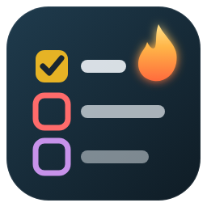
</p>

<h1 align="center">TodoForge</h1>

<p align="center">
  <b>Every TODO in your code, in one tree, with owners, due dates and a Changes view for your branch.</b><br>
  Fast on big .NET and web repos. Offline. No account. No telemetry.
</p>

<p align="center">
  <a href="https://marketplace.visualstudio.com/items?itemName=onurkarakus.todoforge"></a>
  <a href="https://marketplace.visualstudio.com/items?itemName=onurkarakus.todoforge"></a>
  <a href="https://open-vsx.org/extension/onurkarakus/todoforge"></a>
  <a href="https://open-vsx.org/extension/onurkarakus/todoforge"></a>
  <a href="https://github.com/onurkarakus/todo-forge/blob/main/LICENSE"></a>
</p>

<p align="center">
  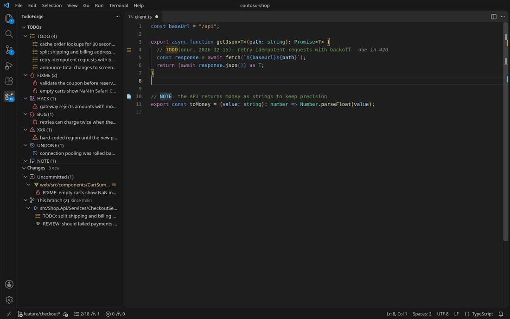
</p>

## Why TodoForge

- **Works on install.** Open a folder and the TODO tree fills in. `bin/`, `obj/`, `node_modules/`, generated C# and minified files are skipped out of the box, and `.gitignore` is honored.
- **TODOs that carry meaning.** Write `TODO(onur, 2026-12-01, !high, #perf): …` and get an owner, a due date that turns red when overdue, a priority and labels. Every part is optional.
- **See what you are adding.** The **Changes** view lists TODOs you have not committed and TODOs added on your branch, from local git. Check it before you open a pull request.
- **Act from the line.** Hover a TODO for who wrote it and when, then Snooze, set a date, set a priority, pin or remove it with one click or **Ctrl+.**
- **Private by design.** Nothing leaves your machine. No sign-in, no telemetry, no network calls. AI help and the Copilot chat tools are off unless you turn them on.

## New in 1.2.1

- **Changes view.** Renamed or moved files no longer list TODOs that only changed path. Only newly added lines appear.

## New in 1.2

- **Relative due dates.** Write `TODO(me, +7d)`, `+2w`, `+1m`, `tomorrow` or `friday` and pick the completion, or use the **Convert +7d to 2026-11-28** quick fix. The comment always gets a fixed ISO date, so it means the same thing next week.
- **Bulk actions in the tree.** Select several TODOs with `Ctrl`/`Shift` (`Cmd`/`Shift` on macOS) and snooze, set a due date or priority, assign to yourself or to someone else, pin, unpin or mute them all at once. Edits to files are one undo step.
- **Instant tree after a reload.** The last scan is saved in VS Code's storage for this workspace and shown right away when the window opens; a fresh scan then runs in the background.
- **Smoother updates.** When a file changes, only the changed rows of the tree are redrawn, so the selection and scroll position stay put.
- **Smaller download.** The Marketplace and Open VSX now serve a package built for your platform with only its own ripgrep binary: about 2–3 MB instead of about 15 MB.
- **Faster multi-root scans.** Workspace folders are scanned in parallel (three at a time).

## Features

### A tree of every TODO

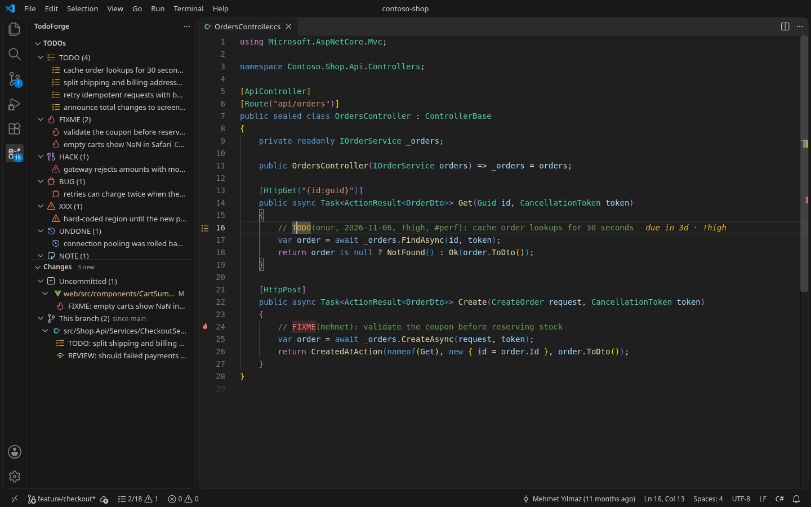

- Group by **tag**, **file**, **owner**, **label** or a flat list. Sort by location, priority, due date or age. Expand or collapse the whole tree, or toggle **Current file** to focus the active editor without changing the scan mode. The tree can follow the file you are in (`todoforge.tree.autoReveal`).
- Finds `TODO FIXME HACK BUG XXX UNDONE NOTE REVIEW OPTIMIZE` and your own tags. `NOTE`, `BUG`, `REVIEW` and `OPTIMIZE` only count with a `:` or `(`, so “// Note that…” is not a TODO.
- Reads real comments in 70+ file types, including Vue, Svelte, JSX/TSX, Astro, Razor, LaTeX and INI files. A `todoList` variable or a `"TODO"` string is not a TODO.
- In C#, also lists `throw new NotImplementedException()`, `[Obsolete]` and `#warning`.
- Markdown checklists (`- [ ]`) get their own group; tick them from the tree.
- **Pins** keep the TODOs you care about at the top, and follow the line when the file changes. Drag to reorder.
- **Mute** a TODO you never want to see again in this workspace.
- **Select many** with `Ctrl`/`Shift`-click and snooze, set a date or priority, assign, pin, unpin or mute them in one go.
- Opens instantly after a reload with the last scan, then refreshes in the background. Only changed rows are redrawn, so your selection and scroll position stay where they were.

### Highlights that follow your theme

Tags are colored in the editor, the gutter and the overview ruler, with separate light and dark colors that pass WCAG AA contrast on the light theme. Recolor built-in tags from your theme with `workbench.colorCustomizations` (`todoforge.todoForeground`, `todoforge.fixmeForeground`, …). You can highlight only the tag, the tag and the text after it, the whole comment or the line; turn the gutter icon off, lower the opacity or add a border. Set `hideFromTree` on a tag (for example `NOTE`) to keep the color in the editor but leave it out of the tree.

TodoForge can also color `// !` (alert), `// ?` (question), `// *` (highlight) and `////` (strikethrough) markers. Those stay in the editor and do not appear in the TODO tree unless the comment also has a real TODO or FIXME tag. If those markers are already being colored in the editor, TodoForge leaves them alone until you set `todoforge.commentMarkers.enabled` yourself, so the colors do not stack.

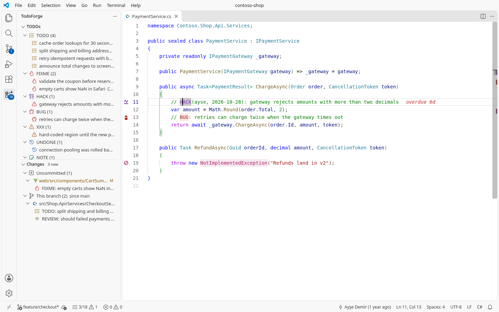

### Owners, due dates and priorities

```csharp
// TODO(onur, 2026-12-01, !high, #perf): cache the price lookup
// FIXME(@ayse): null check before Save()
// HACK(2026-11-15): remove after the API fix ships
```

- Overdue and due-soon TODOs show a hint at the end of the line (`overdue 6d`, `due in 3d · !high`).
- **Relative dates.** Inside `TODO(…)`, type `+7d`, `+2w`, `+1m`, `today`, `tomorrow` or a weekday name (`monday` … `sunday`, English) and accept the completion to insert the real date. Already wrote `TODO(me, +7d)`? The **Convert +7d to 2026-11-28** quick fix (`Ctrl+.`) or **TodoForge: Convert Relative Due Dates in This File** writes the ISO date into the comment. A weekday means the next one, never today; `+1m` keeps the day of the month (Jan 31 + 1m is the last day of February).

```csharp
// TODO(onur, +7d): …        →  TODO(onur, 2026-11-28): …
// FIXME(friday, !high): …   →  FIXME(2026-11-27, !high): …
```

- Type `todo` in a comment and pick **TODO(owner, date)** to get the snippet.
- Your name comes from `todoforge.syntax.owner` or your local `git config user.name`.
- Ticket tokens such as `#123` or `FIXME[JIRA-123]` become links in the hover card when you set `todoforge.general.ticketUrl` (for example `https://github.com/org/repo/issues/${token}` or `https://jira.example.com/browse/${token}`). Clicking them opens your browser. TodoForge itself makes no request.

| Hover card | Quick fixes |
| --- | --- |
| 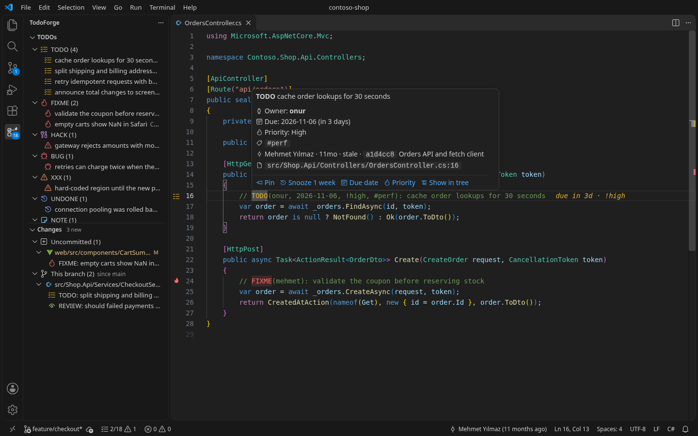 | 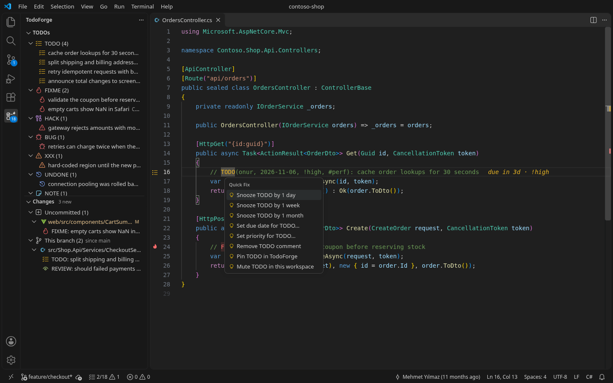 |

### Changes: TODOs on your branch

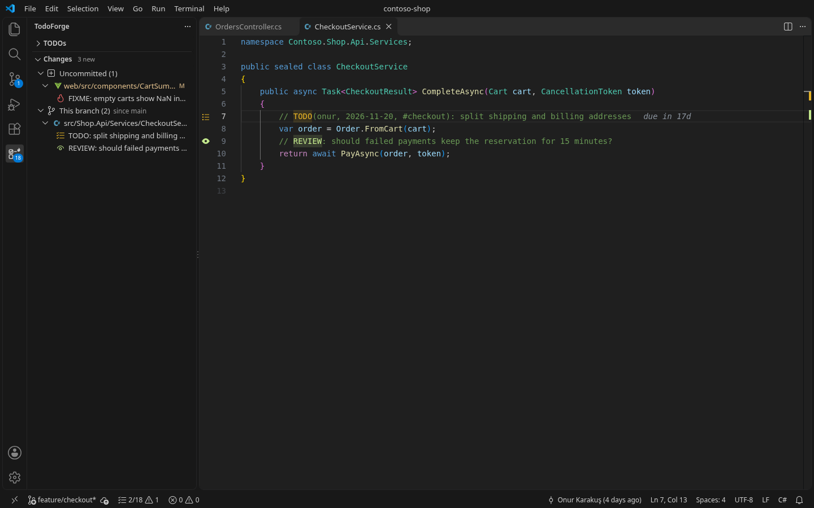

TodoForge runs read-only local git commands (`git diff`, `git ls-files`, `git merge-base`, `git blame`) to split TODOs into **Uncommitted** and **This branch**. Renamed or moved files do not list TODOs that only changed path; only newly added lines appear. The base branch is detected (`origin/HEAD`, `main`, `master`, `develop`) or set with `todoforge.git.baseBranch`. Nothing is fetched.

### Filter as you type

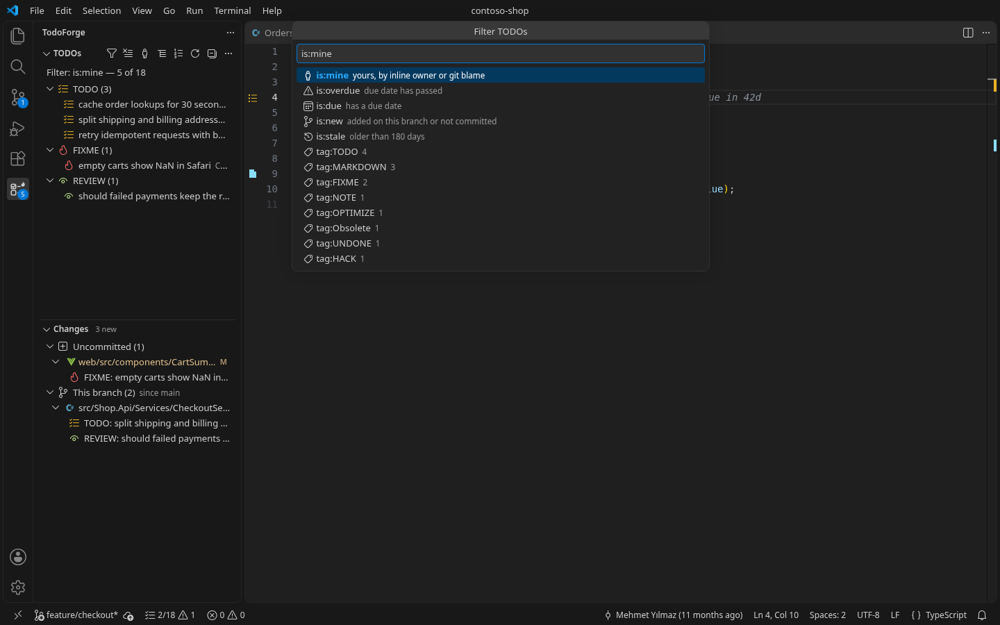

| Query | Shows |
| --- | --- |
| `is:mine` | yours, by inline owner or git blame |
| `is:overdue`, `is:due` | past due, has a due date |
| `is:new` | uncommitted or added on this branch |
| `is:stale` | older than `todoforge.stale.afterDays` (git blame) |
| `tag:FIXME,BUG` | these tags |
| `@ayse`, `#perf`, `path:src/api` | owner, label, path |
| `-word`, `-tag:NOTE` | exclude |

Save any filter as a **view**. Built-in views: My TODOs, Overdue, Due dates, New on this branch, Stale, FIXME and BUG, .NET code markers.

### Insights

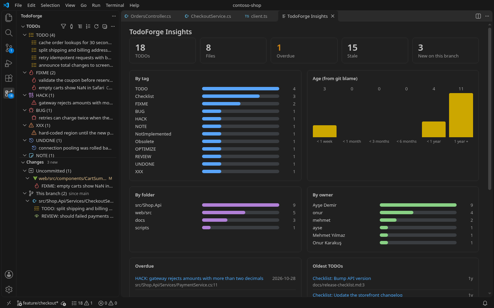

Counts by tag, folder and owner, age from git blame, and the overdue and oldest TODOs. It is a local webview with a strict content security policy: no scripts or styles from the network.

### Ask Copilot about your TODOs

TodoForge adds three read-only tools for Copilot Chat and agent mode (VS Code 1.95 or later). They are **off by default**: set `todoforge.ai.chatTools` to `true` (or use the **Ask Copilot about your TODOs** step in Get Started) to turn them on.

| Tool | Reference | What it returns |
| --- | --- | --- |
| List TODOs | `#todos` | TODOs filtered by file, tag, owner, label, priority, overdue, due soon, stale, mine, new, uncommitted or this branch |
| TODO Changes | `#todoChanges` | TODOs you have not committed and TODOs added on this branch |
| TODO Details | `#todo` | One TODO with its metadata and git blame |

| | |
| --- | --- |
| 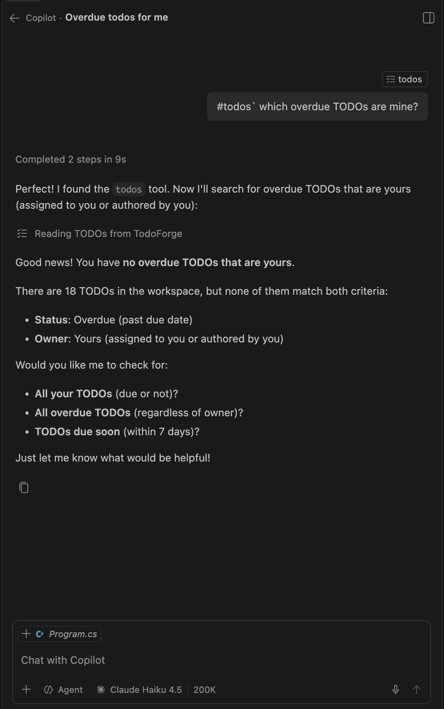 | 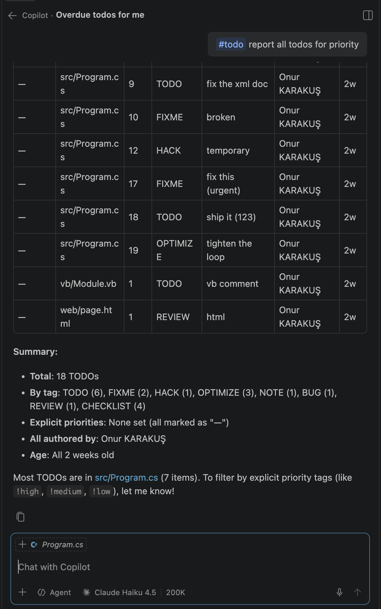 |

Ask “which overdue TODOs are mine?”, “what TODOs did I add on this branch?” or “plan the FIXMEs in `src/api`”. Results are capped (50 by default, 200 at most) so a large repo does not flood the chat.

The tools read the index TodoForge already has. They never read surrounding code and make no network request. They run only when you chat and the model calls them, and VS Code shows each call. They are off in untrusted workspaces. Without Copilot or another chat extension, or on VS Code older than 1.95, nothing changes.

### Explain a TODO with AI

Turn on `todoforge.ai.enabled`, then right-click a TODO in the tree, or put the cursor on a TODO and open **TodoForge** in the editor's right-click menu, and pick **Explain TODO with AI…** (also in the Command Palette). The first time, TodoForge asks for your consent. It then sends the TODO and up to 40 lines around it to a chat model you already have in VS Code, such as GitHub Copilot (you pick one if there are several). The answer streams into a Markdown tab beside your code: what the TODO asks for, a short plan, a code sketch and open questions. Off by default and off in untrusted workspaces.

### Get started in a minute

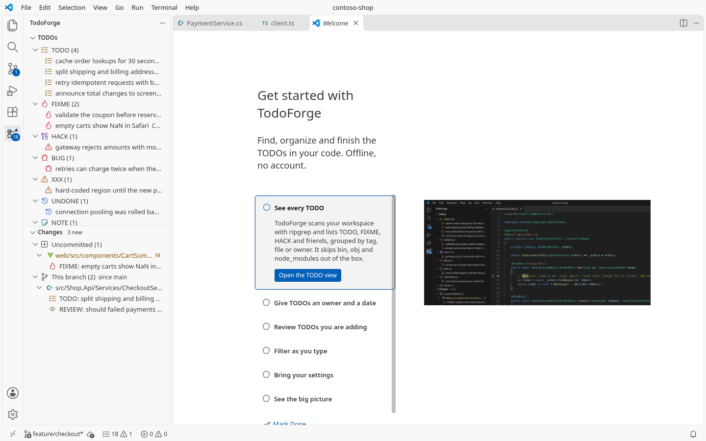

The walkthrough opens from **TodoForge: Get Started**. If you already have tags, excludes or comment markers set up, **TodoForge: Import Settings** can bring them over. The same command also reads Visual Studio (`.vssettings`) and Rider (`.DotSettings`) files.

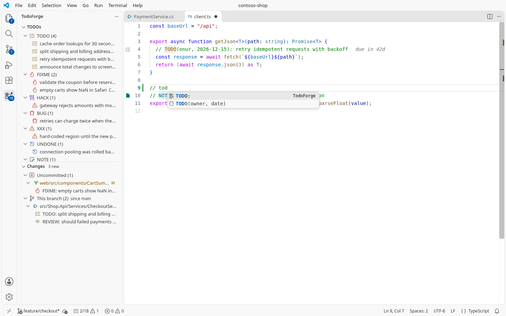

## Commands and keys

| Command | Key |
| --- | --- |
| Go to Next TODO in File | `Ctrl+Alt+PageDown` (`Cmd+Alt+PageDown`) |
| Go to Previous TODO in File | `Ctrl+Alt+PageUp` (`Cmd+Alt+PageUp`) |
| Filter… (when the tree has focus) | `Ctrl+Alt+F` (`Cmd+Alt+F`) |
| Quick fixes on a TODO | `Ctrl+.` (`Cmd+.`) |
| Snooze / Set Due Date / Set Priority / Assign to Me / Assign Owner… / Pin / Mute on many TODOs | select them in the tree, right-click |
| Convert Relative Due Dates in This File | Command Palette, editor right-click menu |
| Go to TODO… | Command Palette |
| Show My TODOs / Show All TODOs | Command Palette, tree toolbar |
| Show Current File Only / Show All Files | Command Palette, tree toolbar |
| Expand All / Collapse All | Command Palette, tree toolbar |
| Open Saved View… / Save Current View… | Command Palette, tree menu |
| Show Insights | Command Palette, tree toolbar |
| Import Settings… | Command Palette, tree menu |
| Copy View as Markdown Checklist / Export View as Markdown… or JSON… | Command Palette, tree menu |
| Open Ticket | hover, tree menu |
| Explain TODO with AI… | tree and editor right-click menu, Command Palette, after you opt in |

## Settings

The defaults are meant to be left alone. The ones people change most:

| Setting | Default | What it does |
| --- | --- | --- |
| `todoforge.general.tags` | `TODO FIXME HACK BUG XXX UNDONE NOTE REVIEW OPTIMIZE` | Tags to find. |
| `todoforge.general.strictTags` | `NOTE BUG REVIEW OPTIMIZE` | Tags that need `:` or `(` after them. |
| `todoforge.general.caseSensitive` | `true` | `todo` in prose is not a TODO. |
| `todoforge.scanning.excludeGlobs` | .NET, node and generated files | Paths to skip. |
| `todoforge.scanning.mode` | `workspace` | Or only open files / the current file. |
| `todoforge.tree.groupBy` | `tag` | `tag`, `file`, `owner`, `subtag`, `flat`. |
| `todoforge.tree.sortBy` | `location` | `location`, `priority`, `due`, `age`. |
| `todoforge.highlighting.style` | `tag` | `tag`, `text` (tag and the text after it), `comment` or `line`. |
| `todoforge.highlighting.inlineHints` | `true` | `overdue 3d` after the line. |
| `todoforge.highlighting.tags` | `{}` | Per-tag colors, icons, ruler, `hideFromTree`, opacity, border. |
| `todoforge.highlighting.gutterIcons` | `true` | Gutter icon next to each TODO. |
| `todoforge.commentMarkers.enabled` | `true` | Color `// !`, `// ?`, `// *` and `////` markers in the editor. |
| `todoforge.general.ticketUrl` | `""` | URL template for `#123` / `JIRA-123`. Opens in the browser on click. |
| `todoforge.tree.autoReveal` | `true` | Reveal the active file in the tree without taking focus. |
| `todoforge.dotnet.codePatterns` | `true` | `NotImplementedException`, `[Obsolete]`, `#warning`. |
| `todoforge.markdown.enabled` | `true` | Find `- [ ]` checklist items. |
| `todoforge.statusbar.format` | `compact` | `2/18 ⚠1`, or per-tag counts. |
| `todoforge.problems.enabled` | `false` | Also list TODOs in Problems. |
| `todoforge.codelens.enabled` | `false` | Pin / Snooze above each TODO. |
| `todoforge.syntax.owner` | `""` | Your name for `is:mine`; empty uses git. |
| `todoforge.stale.afterDays` | `180` | When a TODO counts as stale. |
| `todoforge.git.enabled` | `true` | Changes view, blame, `is:mine`. |
| `todoforge.git.baseBranch` | `""` | Branch for “This branch”; empty detects it. |
| `todoforge.ai.enabled` | `false` | Opt in to Explain TODO with AI. |
| `todoforge.ai.chatTools` | `false` | Opt in to the Copilot Chat tools (`#todos`, `#todoChanges`, `#todo`). |

All 50 settings are listed in the Settings editor under **TodoForge** (**TodoForge: Open Settings**).

## Privacy

- **No network.** TodoForge makes no HTTP requests. Scanning uses the bundled ripgrep; git features run local, read-only git commands. Ticket links and raw URLs open in your browser only when you click them.
- **No telemetry, no account, no sign-in.**
- **Your data stays in VS Code.** Pins, muted TODOs and saved views live in VS Code's workspace and global state. The last scan result (TODO lines and their metadata, at most 20,000 TODOs) is kept in VS Code's storage for this workspace so the tree opens instantly; it is never written to your repo. Nothing is written to your repo unless you edit a TODO (snooze, set a date, remove) or export a view.
- **AI is opt-in.** With `todoforge.ai.enabled` on, **Explain TODO with AI** asks for consent once, then sends only the TODO and nearby lines to a chat model you already have in VS Code (for example GitHub Copilot). Off by default, and off in untrusted workspaces.
- **Chat tools are opt-in.** Off by default; turn on `todoforge.ai.chatTools`. When they are on and you chat with Copilot (or another chat model in VS Code) and the model calls a TodoForge tool, the tool returns TODO lines and their metadata (path, line, tag, text, owner, dates, labels, blame author) from TodoForge's local index to that chat. That chat model, and its provider's terms, then see that data, as with any file you attach. TodoForge makes no request itself, never sends surrounding code, and does nothing when you do not chat.
- **Untrusted workspaces.** Scanning and highlights work; git, the workspace's custom regex, AI and the chat tools stay off.

See [SECURITY.md](https://github.com/onurkarakus/todo-forge/blob/main/SECURITY.md) for how to report a problem.

## FAQ

**Does it work alongside other TODO or comment-highlighting extensions?** Yes. They can run together; turn one off if highlights stack. If another extension is already coloring `// !`, `// ?`, `// *` or `////` markers, TodoForge leaves those markers to it until you set `todoforge.commentMarkers.enabled` yourself. **Import Settings** can copy tags, excludes and markers from other TODO and comment-highlighting extensions, and from Rider and Visual Studio.

**My TODO is not found.** Check that it is in a comment, that the tag is in `todoforge.general.tags`, and that the file is not excluded (`.gitignore`, `files.exclude`, `todoforge.scanning.excludeGlobs`). Strict tags (`NOTE`, `BUG`, …) need a `:` or `(`. The **TodoForge** channel in the Output panel has the details.

**How fast is it?** Activation does not wait for the scan, and after a reload the tree shows the saved index within a few dozen milliseconds. On a 20,000-file test repo a full scan takes about 55–80 ms and one changed file about 7–10 ms. Four workspace folders of 5,000 files each scan in about 50 ms instead of about 77 ms one by one. Details in [docs/perf-notes.md](https://github.com/onurkarakus/todo-forge/blob/main/docs/perf-notes.md).

**Does it support Remote SSH, WSL, Dev Containers and Codespaces?** Yes, it runs where your files are. It does not support virtual workspaces (such as vscode.dev with a GitHub repo) because it needs ripgrep and git.

**Where do pins and saved views go?** VS Code's storage for this workspace (pins, mute) and for you (saved views). Not in your repo.

More answers in [docs/faq.md](https://github.com/onurkarakus/todo-forge/blob/main/docs/faq.md).

## Feedback

Found a bug or missing something? [Open an issue](https://github.com/onurkarakus/todo-forge/issues). Release notes are in [CHANGELOG.md](https://github.com/onurkarakus/todo-forge/blob/main/CHANGELOG.md).

TodoForge is MIT licensed.
